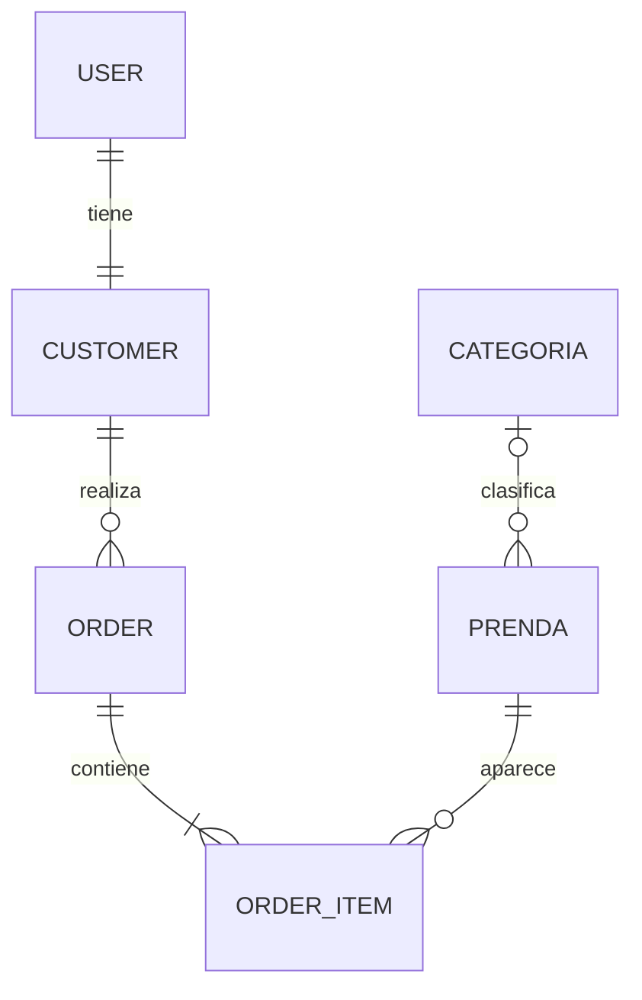

# Modelo entidad-relación · SILEN Clothing · Lab 3

| Relación | Cardinalidad | onDelete y justificación |
|---|---|---|
| User–Customer | 1:1, `customer.userId @unique` | `Cascade`: elimina el perfil al eliminar al usuario. |
| Customer–Order | 1:N | `Restrict`: conserva historial y evita borrar clientes con pedidos. |
| Order–OrderItem | 1:N | `Cascade`: elimina líneas si se elimina el pedido. |
| Prenda–OrderItem | 1:N (Order–Prenda es N:M) | `Restrict`: impide eliminar una prenda con historial de compras. |
| Categoria–Prenda | 1:N | `SetNull`: elimina la categoría sin borrar inventario. |

`OrderItem` modela N:M explícita y guarda `quantity` y `unitPrice` como precio histórico. `Role` y `OrderStatus` son enums. `Prenda.precio`, `Order.total` y `OrderItem.unitPrice` usan Decimal(10,2); las fechas usan DateTime. Hay índice compuesto `[status, createdAt]`, clave compuesta `[orderId,prendaId]`, campos `@map` y tablas `@@map` snake_case. El campo de texto `categoria` original se conserva por compatibilidad y `categoriaId` agrega la FK real.
