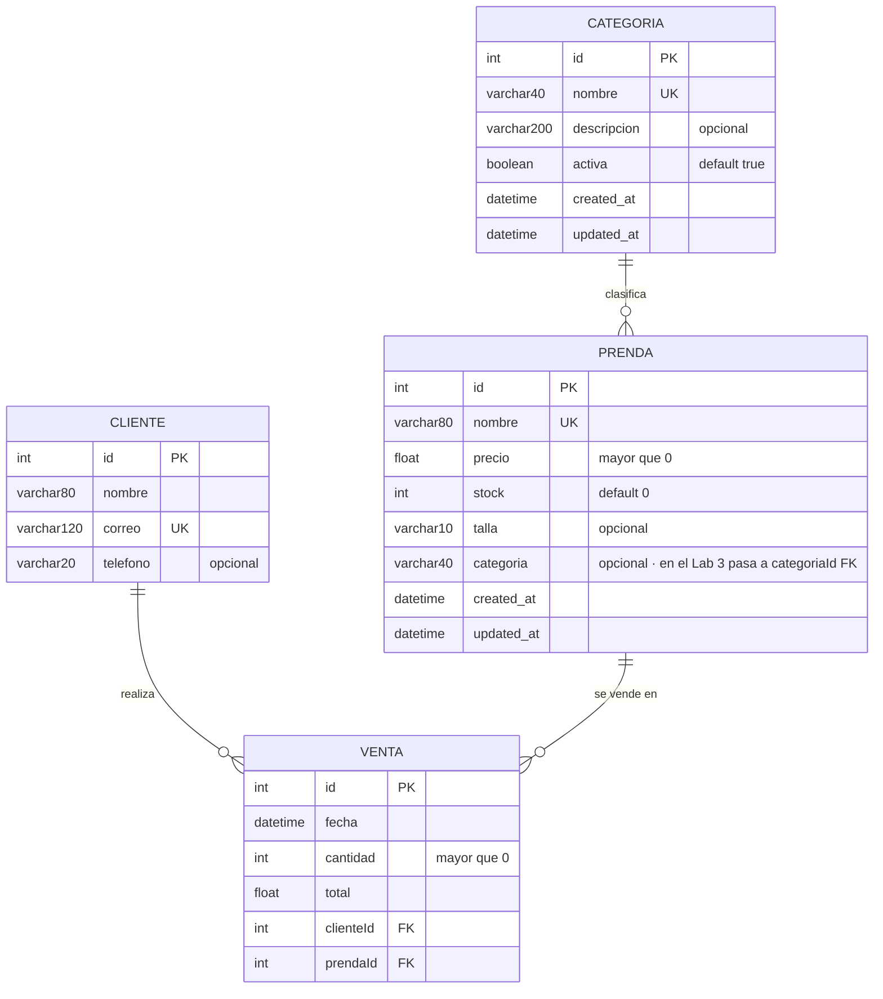

# Modelo ER del emprendimiento · Grupo G5 · SILEN Clothing

> Actividad 3 de la sesión 4. Es la base del `schema.prisma` del Lab 2 y de las relaciones del Lab 3.

## Diagrama

## Entidades

| Entidad | Atributos (tipo) | Clave primaria | Únicos / obligatorios / reglas |
|---|---|---|---|
| **Prenda** (`prendas`) | id (Int), nombre (VarChar 80), precio (Float), stock (Int), talla (VarChar 10), categoria (VarChar 40), created_at, updated_at (DateTime) | `id` autoincremental | `nombre` único y obligatorio (3–80 caracteres) · `precio` obligatorio y mayor que 0 · `stock` entero ≥ 0, por defecto 0 · `talla` y `categoria` opcionales |
| **Categoria** (`categorias`) | id (Int), nombre (VarChar 40), descripcion (VarChar 200), activa (Boolean), created_at, updated_at (DateTime) | `id` autoincremental | `nombre` único y obligatorio · `descripcion` opcional · `activa` por defecto `true` |
| **Cliente** (`clientes`) | id (Int), nombre (VarChar 80), correo (VarChar 120), telefono (VarChar 20) | `id` autoincremental | `correo` único y obligatorio · `telefono` opcional |
| **Venta** (`ventas`) | id (Int), fecha (DateTime), cantidad (Int), total (Float), clienteId (Int), prendaId (Int) | `id` autoincremental | `cantidad` mayor que 0 · `clienteId` y `prendaId` obligatorios (claves foráneas) |

## Relaciones

| Entidad A | Cardinalidad (1:1, 1:N, N:M) | Entidad B | Ejemplo en una frase |
|---|---|---|---|
| Categoria | 1:N | Prenda | Una categoría («Camisetas») agrupa muchas prendas; cada prenda pertenece a una sola categoría. |
| Cliente | 1:N | Venta | Un cliente puede realizar muchas ventas; cada venta es de un solo cliente. |
| Prenda | 1:N | Venta | Una prenda aparece en muchas ventas; cada venta registra una sola prenda (con su `cantidad`). |
| Cliente | N:M (a través de Venta) | Prenda | Un cliente compra muchas prendas distintas y una prenda es comprada por muchos clientes; `Venta` es la tabla intermedia. |

## ¿Qué se implementa en cada laboratorio?

- **Lab 2:** la entidad principal **Prenda** y una segunda entidad **Categoria** en `prisma/schema.prisma`, **sin relaciones** (sin `@relation`). Por eso `Prenda.categoria` sigue siendo un texto, igual que en el Lab 1, y la API no cambia su contrato.
- **Lab 3:** las relaciones (`@relation`), las claves foráneas (`Prenda.categoriaId`, `Venta.clienteId`, `Venta.prendaId`) y las entidades restantes **Cliente** y **Venta**.
