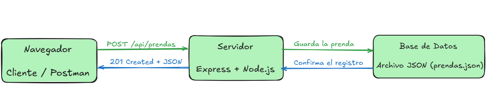

# Propuesta del emprendimiento · Grupo G5

> Actividad 1 de la sesión 1. Complétala antes del Paso 1 del laboratorio.

| Campo | Respuesta |
|---|---|
| Nombre del emprendimiento |SILEN Clothing |
| Problema que resuelve |Como grupo, decidimos crear SILEN Clothing, un emprendimiento dedicado a la venta de ropa urbana. Al planificar nuestro negocio, identificamos la necesidad de llevar un control organizado de las prendas, tallas, precios y cantidades disponibles, ya que administrar esta información manualmente podría ocasionar errores en el inventario y dificultades para gestionar nuestros productos. |
| Usuarios (quién lo usa) |Los administradores y empleados de SILEN Clothing, quienes utilizarán el sistema para gestionar las prendas, consultar el inventario y actualizar la información de los productos. |
| 3 funciones principales | 1. Registrar prendas en el inventario.   2. Consultar las prendas disponibles.   3. Actualizar y eliminar prendas del inventario. |

## Mapa frontend–backend

Pega aquí la imagen del diagrama (Excalidraw o Mermaid): navegador → servidor → base de datos, con sus flechas.
   

## Entidades (3) y atributos principales

| Entidad | Atributos | ¿Se relaciona con…? |
|---|---|---|
| Prendas (entidad del Lab 1) | id, nombre, precio, stock, talla, categoria | Ventas |
| Clientes | id, nombre, correo, telefono | Ventas |
| Ventas | id, fecha, cantidad, total, clienteId, prendaId | Clientes y Prendas |
> La primera entidad es la que implementan en este laboratorio (4 o más campos). Las otras dos se usan en los Labs 2 y 3.

## 3 endpoints iniciales

| Verbo | Ruta | Código de estado |
|---|---|---|
| GET | /api/prendas | 200 |
| POST | /api/prendas | 201 |
| PUT | /api/prendas/:id | 200 |
